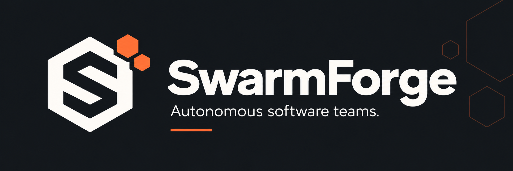

# SwarmForge



An autonomous multi-agent software team built from Chinese open models (Qwen, DeepSeek, Kimi,
GLM, MiniMax) served by DeepInfra.

Use **Projects** to turn an approved app spec into a rolling milestone plan. Open **What's new**
for searchable, plain-language feature highlights and links to each change. See the
[Projects and feature history guide](docs/PROJECTS.md) for the workflow, CLI and current boundaries.

**You give it a GitHub issue URL → a planner breaks it into a task graph → two coding agents
work in parallel in isolated git worktrees → their work is merged → a test engineer writes
acceptance tests → the orchestrator runs the tests itself → an independent reviewer reviews the
diff → blocking problems trigger corrective tasks (bounded by `limits.max_repair_cycles`) → you get a
tested draft pull request and an execution report** that records what each agent did, the tokens
and cost, and every human intervention.

```
swarmforge run https://github.com/you/repo/issues/42
```

Current local team (`swarmforge.yaml`, 2026-11-02):

| Role | Model (DeepInfra) | Runtime / tools |
|---|---|---|
| Planner / Eng. manager | `Qwen/Qwen3.8-Flash` | built-in; read-only, `submit_plan` |
| Backend developer | `zai-org/GLM-5.3` | Pi; read/write/edit/bash and SwarmForge developer tools via `sf` |
| Frontend developer | `zai-org/GLM-5.3` | Pi; same tools, runs concurrently |
| Reviewer | `moonshotai/Kimi-K2.6` | built-in; read-only, `submit_review` |
| Test engineer | `Qwen/Qwen3.8-Flash` | built-in; test files only, sandboxed commands, dev tools, `submit_test_report` |
| Librarian | `deepseek-ai/DeepSeek-V4-Flash` | built-in; read-only, `submit_notes` (Zettelkasten) |
| Designer | `Qwen/Qwen3-VL-235B-A22B-Instruct` | screenshot review for configured UI previews |

This is a dated snapshot of the local team, also committed in `profiles/team-current.yaml`, not
the installation defaults. Add `team_profile: profiles/team-current.yaml` to select it; paths resolve
relative to the configuration file. Profiles override model/runtime settings only, never permissions.
`swarmforge.example.yaml` retains a built-in-runtime team using Qwen3.5, DeepSeek, Kimi, GLM and
MiniMax. Copying that example does not select the local team above. Any role can use any model;
the reviewer must differ from developer models unless explicitly overridden.

## Principles

* **Agents propose, code decides.** State transitions, the approval gate, test verdicts, merges
  and GitHub publishing are deterministic code. A model can't declare tests passed: the
  orchestrator runs them and reads JUnit.
* **Sandboxed by default.** Docker containers use a read-only root filesystem, dropped capabilities
  and scoped writable mounts. Built-in commands default to no network; Pi sessions use
  `pi.network` (normally `bridge`) to reach the host model relay. Bridge networking is not a
  relay-only firewall. Provider keys stay on the host; Pi receives a per-agent relay token.
  See [docs/SECURITY.md](docs/SECURITY.md) for the boundaries and exceptions.
* **Publishing and merging are configurable.** Branches use `swarmforge/*` and are never
  force-pushed. The example requires push approval and disables automatic merging. The local
  configuration skips push approval and enables auto-merge for `bigdan88/swarmforge`; eligible
  draft PRs can therefore be merged automatically. See [delivery](#when-a-run-finishes).
* **Measured, not guessed.** Each model call records tokens and DeepInfra's reported cost.
  Estimates and missing data are labelled as such.

## Install

Requires Python 3.11+, Git, and Docker Desktop (or Docker Engine).

```bash
python -m venv .venv
# Windows: .\.venv\Scripts\Activate.ps1     macOS/Linux: source .venv/bin/activate
pip install -e ".[dashboard]"          # add ,dev for the test suite
cp swarmforge.example.yaml swarmforge.yaml
cp .env.example .env                   # put DEEPINFRA_API_KEY (and optionally GITHUB_TOKEN) here
swarmforge sandbox build               # builds swarmforge-sandbox:latest (python + pytest)
swarmforge check --live                # config, docker, models, prices, live tool-calling test
```

## Use

The dashboard is the control center:

```bash
swarmforge dashboard          # opens http://localhost:8501
```

* **Work**: one list of everything: running runs, waiting queue tasks, finished and failed work,
  with filters (All / Active / Waiting / Finished / Failed) and search. **Click any task** to open
  it right underneath. **Tick the boxes** to act on several tasks at once: delete (with their run
  history and, optionally, their files), cancel, run again, or move to the front of the queue.
  Opening a task shows:
  * **Waiting task**: change anything (title, description, repository, team, budget, repair cycles,
    time limit, chaining, GitHub approval), move it up/down or to the front, or remove it.
  * **Running run**: change its budget, time limit and repair cycles while it runs (applied within a
    few seconds, no restart), or cancel it. Approve or decline GitHub pushes.
  * **Failed/stopped run**: start it again from scratch, or continue from where it stopped, with new
    limits.
  * Every run shows these tabs: **Delegation** (planner → tasks → agents → tester → reviewer →
    repair cycles, with each agent's brief and hand-back), **Agents & timeline**, **Transcripts**
    (each agent's prompt, reasoning, tool calls and results), **Tests, Review, Knowledge, Tokens &
    cost, Console, Events**.

  The queue bar at the top starts, pauses and resumes the queue worker. Queued tasks run one after
  another; with chaining, each task starts from the previous task's result on the same repository.
  CLI: `swarmforge queue import FILE --repo R`, `queue list`, `queue resume`, `queue pause`.
* **New task**: the repository field remembers the repositories you used before (newest first)
  and still accepts a new folder, owner/repo or URL. *Start now* (describe the work or paste a GitHub issue URL, point it at a
  repository, set budget, repair cycles and time limit, **Start run**; **Prepare sample** for a
  one-click demo) or *Add to the queue* (one task, or import a backlog file such as
  `docs/SELF_IMPROVEMENT_BACKLOG.md`). Runs are background processes and keep going if you close
  the browser.
* Every page has its own address (`?page=work`, `?page=failures`, …), handy for bookmarks on an iPad.
* **Chat**: ask the assistant about run and swarm statuses.
* **Knowledge**: the Zettelkasten. Browse, search, edit and link notes, view the note graph,
  and write your own notes for the agents to use.
* **Benchmarks**: single agent vs swarm comparisons.

Everything is also available from the CLI:

```bash
swarmforge run https://github.com/OWNER/REPO/issues/N        # or --issue-file F --repo PATH
swarmforge runs | status [RUN] | logs -f [RUN] | cancel RUN | report [RUN]
swarmforge ask "which runs failed and why?"                       # chatbot answers from run data
swarmforge publish RUN                                        # push + draft PR later
swarmforge bench ISSUE --repo PATH --acceptance DIR           # single agent vs swarm
```

Machine-readable output (added by SwarmForge itself in its first self-improvement run):
`swarmforge runs --json` prints a JSON array of runs (id, mode, state, cost_usd, total_tokens, …);
`swarmforge status [RUN] --json` prints one object with the same fields plus
`integration_branch`, `pr_url`, `repair_cycle`, `interventions` and a `tasks` list. An unknown
run prints `{"error": "run not found: <id>"}` and exits with status 2.

## Agent developer tools

Developers, the conflict resolver and the test engineer get, besides files and `run_command`:

| Tool | What it does |
|---|---|
| `start_process` / `read_process_output` / `stop_process` | Run a server or app in the background (e.g. `streamlit run app.py --server.headless true --server.port 8501`), wait until a port or log line says it's ready, read its output, stop it. |
| `browse` | Open `http://localhost:<port>` in headless Chromium: visible text, errors shown on the page (Streamlit exceptions, tracebacks, `role=alert`), uncaught JS errors, console errors, failed requests and the clickable elements. Optional actions (click, fill, press, select, wait) run first; optional screenshot to the run's artifacts. Local URLs only. |
| `check_code` | `ruff` + `mypy` on the changed files (or given paths), returned as `file:line:col code message`. Respects the project's own ruff/mypy config. |
| `run_tests` | Runs the project's test command with pytest JUnit output and returns a structured summary: pass/fail counts, then each failure's node id, assertion message and the last ~15 traceback lines. Optional paths, `-k` keyword and `--lf`. |
| `outline` | Lists a file's structure with line numbers: classes, functions and methods with signatures (Python, via `ast`), Markdown headings, or the top-level keys of JSON/YAML. |
| `find_symbol` | Finds where a function, class or variable is defined and every reference to it across the repo's Python files (real `ast` analysis, so strings/comments containing the name are not reported) as `file:line` plus the source line. |
| `git_changes` | Read-only diff of the agent's worktree against the run's base commit: files changed (including untracked), then the diff, capped in size. |
| `git_history` | Read-only `git log` for one file (hash, date, subject), optionally `git blame` for a line range. |
| `http_request` | Sends a request to a local app started with `start_process` (localhost/127.0.0.1 only, like `browse`) and returns the status, headers and a truncated body (pretty-printed when JSON). |
| `format_code` | Runs `ruff format` on the given files, or by default on the Python files the agent changed, and reports which files were reformatted. |
| `list_packages` | Lists the packages installed in the sandbox with versions, or checks whether one module is importable and from where. |

The reviewer and the planner additionally get the read-only subset `outline`, `find_symbol`,
`git_changes` and `git_history` (no execution, HTTP or formatting tools).

They run where `run_command` runs, with the same isolation: in Docker, one long-lived session
container per agent (read-only root, dropped capabilities), which is killed with every
process in it when the agent finishes. The tools need the rebuilt sandbox image
(`swarmforge sandbox build`, plus `--dev` for SwarmForge's own runs); the browser adds roughly
500 MB to the image. In `sandbox.mode: local`, install them with `pip install -e ".[tools]"` and
`python -m playwright install chromium`. Turn them off with `sandbox.dev_tools: false`.
Built-in sessions use `sandbox.network` (default `none`); tools sharing a Pi session inherit
`pi.network`, normally `bridge`. Orchestrator test containers use `sandbox.network`.

## When a run finishes

* **GitHub repository:** after the gates pass, SwarmForge asks for approval (the *Approval needed* box in
  the dashboard; it auto-declines after `approval.timeout_s`), pushes a `swarmforge/*` branch and opens
  a **draft** pull request. Push approval applies when `github.require_push_approval` is enabled;
  pre-approved runs skip the question. With `auto_merge.enabled: false` (the default), you merge
  the PR yourself, on GitHub or through the dashboard. Auto-merge is a separate setting: it checks
  run/test evidence and PR status, merges small clean changes, and asks a judge model about larger
  changes. `auto_merge.protected` and `major_findings` select judge or hold behavior. Oversized
  changes are held; `auto_fix` can launch a bounded follow-up run for a held PR.
  The local configuration enables this only for `bigdan88/swarmforge`: 400-line clean-change
  threshold and 3,000-line judge limit. Protected files and major findings are now held for human
  review. The local gate blocks critical and major findings and requires JUnit plus verified criteria.
  Updating the running checkout still requires **Update & restart**.
* **Local repository:** the result is delivered as a new branch in your repository; merge it yourself.
* Every run gets a **summary** (dashboard: *Task & summary*; file: `<run dir>/summary.md`): the request
  as you wrote it, what was done (approach, work items, files changed, tests, acceptance criteria,
  review), what you need to do next, and the lessons recorded in the knowledge base. The PR body starts
  with the request too.
* **Lessons** go to the knowledge base automatically: the librarian writes pitfall/review-lesson notes
  whenever a run failed, needed repairs or had problems; failed runs also get a post-mortem note; and
  every run gets a run-log note containing its request and summary.

## Hand issues over with a label (`swarmforge watch`)

List repositories under `watch: repos:` in `swarmforge.yaml`, then run `swarmforge watch` (leave it
running; `--once` polls a single time). Adding the `swarmforge` label to an issue queues it; the issue
is relabelled `swarmforge:queued` -> `swarmforge:working` -> `swarmforge:done`/`swarmforge:failed`,
and SwarmForge comments when it's queued and when it finishes (summary + draft PR link). The run reads
the issue from GitHub, so the PR says "Addresses #N". Pushing still waits for your approval unless
`watch.approval: yes`. The token needs Issues: write for labels and comments. Re-add the label to
retry. (Modelled on the OpenHands issue resolver, but the agents run on your machine.)

## SWE-bench Lite (`swarmforge swebench`)

```
swarmforge swebench fetch --limit 10            # task instances (problem statements only)
swarmforge swebench run --label try1 --limit 3  # one full run per instance -> predictions.jsonl
swarmforge swebench eval --label try1           # official harness: resolved / total
```
Agents see only the issue text. Patches exclude test files (the harness applies its own tests). The
evaluation uses the official harness (`pip install swebench`, needs Docker; on Windows run it in WSL
with the command `eval` prints, then run `eval` again to record the result). Results are stored as a
benchmark and on the variant the runs used. Limitation: the sandbox doesn't reproduce each project's
test environment, so agents often can't run the project's tests while working. Each instance is a full
run: start with a few.

## Variants and the evolve loop (`swarmforge variants`)

A variant is a validated overlay on `swarmforge.yaml`: per-role models and step/time limits, team limits
(tasks, repair cycles, concurrency, retries) and extra prompt guidance per role group (planner,
developer, tester, reviewer, librarian). Sandbox, network, GitHub, budget and approval settings can't
be changed by a variant. All variants are kept in an archive with their scores, as in the Darwin
Gödel Machine:

```
swarmforge variants list                     # tree of variants with scores
swarmforge variants eval v0                  # score the base config on bench/suite.yaml
swarmforge variants evolve --generations 3   # pick a parent (high score, few children), let the
                                             # planner model propose one change, score it, archive it
swarmforge variants show v3                  # overlay, rationale, scores
swarmforge variants use v3                   # apply it to every run (writes active_variant)
```
Score = share of hidden acceptance tests passed on the suite's cases (`bench/suite.yaml`; add cases,
and use `--runs 2+` because single runs are noisy). SWE-bench results recorded with `swebench eval`
appear on the variant too. Nothing changes for real runs until you `use` a variant.

## Pi (pi.dev) as the developer harness

Set `runtime: pi` on a developer role (your `swarmforge.yaml` does this for both developers) to run
the [Pi coding agent](https://pi.dev) instead of SwarmForge's built-in tool loop. Planner, tester,
reviewer and librarian keep the built-in loop because they return structured reports.

* Pi runs **inside the agent's sandbox container** with its own read/write/edit/bash tools; the image
  (`swarmforge sandbox build`) includes Node.js and Pi (`PI_VERSION` build arg, default 1.4.0).
* Pi never talks to DeepInfra and never sees the API key. It talks to a **model relay** SwarmForge
  runs on the host, which forwards every call through SwarmForge's own client: role model, fallbacks,
  busy retries, thinking level, budget, per-task cost metering and the step limit all still apply, and
  the relay writes the transcript the dashboard shows.
* Pi starts with project-local extensions, skills, MCP, prompt templates and sessions disabled, so a
  repository can't load code into the harness.
* **Trade-off:** Pi's container uses the `bridge` network (`pi.network`) so it can reach the relay.
  Its shell and `sf` session tools share that network, which can also permit outbound access;
  SwarmForge does not restrict it to the relay. Built-in sessions and orchestrator tests use
  `sandbox.network` (default `none`). If Pi can't reach the relay on Docker Desktop, set
  `pi: {relay_host: 0.0.0.0}`.
* In `sandbox.mode: local`, install Pi on the host: `npm install -g @earendil-works/pi-coding-agent`.

**SwarmForge's developer tools in Pi (`sf`).** Pi developers also get the tools built-in agents have,
as a shell command they run with bash. `sf` calls back to SwarmForge through the same relay, with the
agent's own one-off token, so the tools run exactly as for built-in agents (same sandbox session,
artifacts and base commit) and need no extra network access:

```bash
sf start web --port 8501 -- streamlit run app.py --server.headless true --server.port 8501
sf browse http://localhost:8501 --click 'text=Settings' --screenshot   # headless Chromium
sf stop web
sf tests tests/test_x.py     sf check     sf fmt     sf changes
sf outline FILE     sf symbol NAME     sf http GET http://localhost:8000/api     sf help
sf edit app.py --lines 12-15 --text 'new code'     # targeted line-range edit (1-based, inclusive)
sf patch app.py '<json hunks or a unified diff>'   # anchored edits; '-' reads the diff from stdin
```

`sf edit` and `sf patch` make **targeted, anchor-validated edits** instead of rewriting whole files:
every hunk carries the exact expected line content (anchor), and SwarmForge validates ALL anchors
against the current file before a single atomic write. Any mismatch rejects the whole edit with a
line-by-line expected-vs-actual error, so a failed edit can never leave a file half-written. The
underlying pure module is `src/swarmforge/pi_edit.py` (`apply_patch` / `edit_lines`), which built-in
agents also get as tools.

For any UI change the developer must open the pages it changed with `sf browse` (screenshots go to the
run's artifacts) before finishing; the tester must do the same for UI acceptance criteria. Tool use is
counted on the **Speed** page (`sf_calls`, `browse_calls`).

## Screenshots and visual review

Tests and code review can't tell whether a page *looks* right. So when a change touches the UI,
SwarmForge itself takes screenshots after every test run and a vision model looks at them:

1. It starts the app the way the repository's `swarmforge.project.yml` says (`preview:`), inside the
   sandbox, and opens each listed page in headless Chromium, once with a light and once with a dark
   browser preference.
2. Pages that show an exception or traceback, fail to load, or throw a JavaScript error are a
   **critical** finding straight away (no model needed): the run goes back for a repair.
3. The screenshots go to the `designer` role (a vision-capable model, `Qwen/Qwen3-VL-235B-A22B-Instruct`
   on DeepInfra, a fraction of a cent per run) together with the task. It reports what a user would
   see wrong: cut-off labels, overlapping or cramped controls, unreadable contrast, parts of a page
   left in the other theme. Only **critical** visual findings (an error, a blank or broken page,
   unreadable text) block; the rest are listed in the PR under *Known limitations*.
4. The run's **Screenshots** tab in the dashboard shows every page, light next to dark, with the
   model's notes.

```yaml
# swarmforge.project.yml (in the repository)
preview:
  command: streamlit run app.py --server.headless true --server.port 8501
  port: 8501
  pages: ["/", "/?page=settings"]          # or {path, name, actions: [{click: "text=Advanced"}]}
  when_changed: ["app.py", "pages/*"]      # only screenshot when these change (default: always)
  viewport: {width: 1400, height: 1400}
```

```yaml
# swarmforge.yaml (yours)
roles:
  designer: {provider: deepinfra, model: Qwen/Qwen3-VL-235B-A22B-Instruct}
vision_models: [Qwen/Qwen3-VL]
```

SwarmForge's own project file screenshots the dashboard on demo data (`swarmforge seed-demo`), so the
pages are filled with runs, queues and failures rather than empty. Without a `designer` role you still
get the screenshots and the automatic error check.

## Auto-merge

Turn on `auto_merge` in swarmforge.yaml and the swarm's pull requests merge themselves:

* **Small, clean changes** (up to `max_lines`, default 400 lines added + deleted, no open [major]
  findings, no core files) merge as soon as the run completes with passing tests.
* **Everything else goes to a judge model** (`judge_role`, default the reviewer): larger changes, PRs
  with open [major] findings (the judge sees them), and PRs touching the repository's `protected_paths`
  (SwarmForge's own core: orchestrator, queue, config, sandbox, agent harness...). It reads the task,
  the diff, the tests and the findings and answers merge or hold with a risk level. Core files need a
  **low** risk verdict, everything else low or medium. Set `protected: hold` or `major_findings: hold`
  to keep those for you instead. Above `judge_max_lines` (3000) a change always waits for you.
* **Conflicts are resolved, not skipped:** if main moved on and the PR conflicts, SwarmForge merges the
  latest main into the branch (an agent resolves the conflicts), re-runs the tests, pushes and merges.
* **A held PR fixes itself once** (`auto_fix`): a fix-up task goes to the front of the same queue,
  continues the held PR's code (with the latest main merged in), addresses exactly why it was held, and
  its PR replaces the old one, which is closed. Only if that is held too does it wait for you.
* **No surprise restarts:** merged code reaches the running SwarmForge with your next Update & restart.

The **Pull requests** page lists every decision with its reason. Anything waiting for you has **Merge
now**, **Fix with the swarm** and **Close**; merged PRs have **Revert** (GitHub creates a revert PR and
it is merged at once). PRs you already merged or closed on GitHub show as no longer open.

## Several queues (one per project)

Every queued task belongs to a **queue** ("pile"); pick it when you add the task (dashboard: *Queue
(pile)*, or type a new name; CLI: `swarmforge queue add ... --queue commanderforge`). Each queue runs
its tasks strictly in order, one at a time; **different queues run side by side** in the same worker
(`limits.max_parallel_queues`, default 3). A failed task (policy "stop") pauses only its own queue;
the others keep going. Pause/resume a single queue from the queue bar or with
`swarmforge queue pause|resume --queue NAME`. Issues from `swarmforge watch` go to the `github` queue
(`watch.queue`). Two queues working on the same repository still take turns (one active run per repo).

## Several runs on one repository (like a team)

With `limits.same_repo: coordinate` (default), several tasks can be worked on the same repository at once,
the way a human team does it:

1. **Manager check before starting.** If other runs are active on the repository, the planner model
   looks at the new task and the work in progress (their issues and plans) and decides: *parallel*
   (different enough), *wait* for specific runs (same code, or builds on them), or *duplicate* (blocked).
2. **Planning around teammates.** The planner is told which files the other runs are changing and
   avoids them where it can. If the accepted plan still edits a file another active run plans to edit,
   this run waits for that run, then starts from the newest base branch.
3. **Own branch.** Every run works in its own clone on its own `swarmforge/*` branch.
4. **Update before the merge request.** Before delivering, the run fetches the latest base branch; if
   it moved (a teammate's PR was merged), it merges it in (an agent resolves conflicts), re-runs the
   tests, and only then opens the draft PR, whose diff shows only this run's work. Failing tests or an
   unresolvable conflict go back into the normal repair cycle.

Time spent waiting doesn't count against a run's time limit. `serial` restores one run per repository;
`parallel` skips all checks.

## Pull requests page and Update & restart

* **Pull requests** (dashboard page): every open PR on the GitHub repositories SwarmForge works on, with
  its status (ready, draft, behind, conflicts), size, and "What the swarm did" for PRs a run opened.
  Tick *I've reviewed these changes*, then **Merge** one or **Merge all ready** (oldest first; drafts
  are marked ready, branches that are only behind main are updated first, PRs that conflict are
  skipped). Choose squash / merge commit / rebase, and whether to delete the `swarmforge/*` branch.
* **⬆️ Update & restart** (sidebar, shown when GitHub has new commits; checked every 5 minutes): pulls
  the merged work into your SwarmForge checkout, installs new Python dependencies if `pyproject.toml`
  changed, restarts the dashboard with the same options (the page reconnects by itself), and restarts
  the queue worker as soon as its running tasks finish. It refuses, without changing anything, if you
  have uncommitted edits or your own commits conflict. If the sandbox Dockerfiles changed it tells you
  to rebuild the images. After merging PRs on SwarmForge itself, the Pull requests page offers the same
  button. From a terminal: `swarmforge update`.
* After a restart the dashboard runs in the background (no terminal window). Its log is in
  `<workdir>/logs/dashboard-restart.log`; stop it with the `Stop-Process` one-liner or by restarting your PC.

## Chat: improve SwarmForge and fix failed tasks

The **Chat** page answers questions about runs and is the place to drive self-improvement:

* **💡 What should we improve next?** The chatbot looks at recent runs, failure categories, slowness,
  lessons in the knowledge base, the platform's README/modules, and what's already queued, then suggests
  2–5 small, independent tasks, each with acceptance criteria and the evidence behind it. Tick the ones
  you want (edit the descriptions if you like), pick a queue or "start each now", and press
  **🚀 Launch** once.
* **🩺 Review my failed tasks** (it shows how many are waiting). For each failed task it explains what went
  wrong and offers 2–4 ways to fix it (more time, smaller scope, a specific fix, continue from the code
  already written). Pick one or write your own instructions, adjust time/budget/repair cycles, and press
  **🔁 Retry with this fix**: the task is queued again (or restarted) with your guidance added, or
  **Dismiss** it.
* **⚡ Why are runs slow or expensive?** plus any free-form question.

Paste a URL to add a fetch hint, or use `/repo owner/name`, `/issues owner/name`, and
`/code topic` for structured prompts. Assistant replies show a collapsible **Tools used**
transcript, retained with the conversation alongside live tool-call captions. The **Tools**
toggle still disables tool execution for a turn.

`chatbot.tools: null` (or an omitted allowlist) preserves available tools; `[]` disables all,
and a list such as `[fetch_url, repo_tree]` permits only those names. Local `run_command`,
`read_file` and `grep` additionally require `chatbot.enable_shell: true`. In Docker mode chat
commands have a read-only project mount, no network and a maximum 30-second timeout;
explicit local sandbox mode runs on the host and provides no container isolation.

The conversation and its buttons survive dashboard restarts. `swarmforge ask "..."` prints the same
suggestions in a terminal.

## Speed

Runs are slow mainly because of repeated full test-suite runs, many large-model calls and hand-offs.
These settings (all on by default) keep that down:

* **Targeted tests.** Agents are told to run only the tests relevant to their change; the orchestrator
  still runs the full `test_command` as the evidence. A repository can name a quicker suite for agents
  with `agent_test_command` in `swarmforge.project.yml` (SwarmForge's own skips the `slow`-marked
  end-to-end tests: `pytest -m "not slow"`).
* **Repository scheduling.** `limits.same_repo: serial` makes a run started while another run on
  the same repository is active waits for it ("waiting: run(s) ... are already working on this
  repository") instead of competing for the model rate limit and editing the same files. Its time
  limit starts when it actually starts. `coordinate` checks for overlap; `parallel` skips those
  coordination checks. The example and current local configuration use `coordinate`.
* **One container per agent** (`sandbox.reuse_container`). `run_command` executes inside the agent's
  long-lived sandbox container instead of starting a new one per command; the timeout is enforced
  inside the container.
* **Fewer, larger tasks.** The local configuration caps plans at 5 tasks; the example caps them at 8.
* **Measure model choices.** The local developers use GLM through Pi; planning and testing use
  Qwen Flash. Compare configurations with `swarmforge bench` before assuming a speed improvement.

* **Tester agent once per run** (`limits.tester_every_cycle: false`). It writes the acceptance tests in
  the first cycle; repair cycles just re-run the suite with them (about 10 minutes saved per cycle).

### Measuring it

Every finished run records where its time went. The **Speed** page and `swarmforge metrics` show it:

* **Phases**: waiting (in line for the repository), setup, planning, coding, testing, review and delivery
  (including waiting for your push approval).
* **Agents by role and model**: sessions, median minutes, seconds per model call, retries; this is how
  you spot a slow model.
* **Counters**: agent timeouts, step-limit hits, busy-model (429) waits, test-suite minutes.
* **By settings**: each run is tagged with a fingerprint of the speed-relevant settings (models and max
  steps per role, repair cycles, blocking severities, tester once/every cycle). Change one setting, let a
  few runs finish, and compare the medians of the two groups.

```bash
swarmforge metrics                       # medians over the last 50 finished runs, grouped by settings
swarmforge metrics RUN_ID                # one run in detail
swarmforge metrics --csv runs.csv        # runs.csv + runs-agents.csv for a spreadsheet or notebook
```

Each run folder also gets a `metrics.json`, and the breakdown is printed in the run's log.

## Failures and self-healing

Every run that fails gets a **post-mortem**. SwarmForge sorts the failure into a cause (time limit,
budget, tests failing, review rejected, environment, ...) and asks the planner model *why it
failed and what the next attempt should do differently*. The post-mortem is kept in three places:

* the dashboard's **Failures** page, with counts by cause and what happened next;
* the run's `postmortem.md`;
* a `failure` note in the knowledge vault, linked from the **Failures** hub note. Later runs on
  the same repository are given these notes, so the agents learn from them.

CLI: `swarmforge failures`, `swarmforge diagnose RUN`.

If a retry can fix the failure, SwarmForge **heals itself**:

* It starts a new attempt that continues from the failed run's code.
* The diagnosis is added to the task.
* The new attempt gets more effort: 1.5x the time, budget and agent steps, compounding with each
  attempt, plus one more repair cycle.
* It never retries problems a human must fix first, such as Docker being down, a missing key or
  a bad repository.
* Retries are capped by *Auto-fix attempts* (default 2, settable per task), by a total budget
  of 3x the task's budget (`self_heal.max_total_budget_usd`) and by a total wall-clock of 3x the
  run's time limit (`self_heal.max_total_runtime_s`, seconds; 0 = the default 3x). When a cap is
  reached, the failure records "not retried: self-healing budget/time cap reached" instead of
  launching another attempt. See `self_heal:` in `swarmforge.example.yaml`.

On the Work page, a task that healed itself shows as "Done (fixed itself, attempt N)". Its earlier
attempts are listed under Failures.

## Repositories and dependencies

The Repository field and `--repo` accept a local git folder, `owner/repo`, or any GitHub URL of the
repo: `https://github.com/owner/repo`, `.../tree/<branch>` (selects that branch), `.../blob/...`,
`.../issues/N`, `git@github.com:owner/repo.git`. Before a run starts, SwarmForge checks that Docker
answers, the sandbox image exists, the API key is set, and the repository is reachable and has at
least one commit. Each problem is reported with its fix, and nothing is spent. Private GitHub
repositories are cloned with your `GITHUB_TOKEN` (or `gh auth login`); the token is never stored in
the clone.

Project dependencies are installed automatically. Packages from `requirements*.txt` or
`pyproject.toml` (or an `install_command` in `swarmforge.project.yml`) go into the worktree's
git-ignored `.swarmforge/pydeps`. Installation uses a network-enabled container and a shared pip
cache. Agents can call `install_dependencies` after adding a package. Built-in commands and
orchestrator tests default to offline execution; Pi session commands use `pi.network` instead.

## Per-project settings

A repository can include `swarmforge.project.yml` with `test_command`, `agent_test_command`,
`agent_env`, `sandbox_image`, `install_command`, `description`, `preview` and `protected_paths`.
Repository settings do not set provider credentials, run budgets or global approval/merge policy;
`protected_paths` is interpreted by the configured auto-merge policy. The dashboard's **Advanced** section and the CLI
flags `--test-command` / `--sandbox-image` override them for a single run. SwarmForge's own
repository uses this to test itself in `swarmforge-dev-sandbox` (`swarmforge sandbox build --dev`).

For a local repository, an approved result is pushed back into it as a new branch
`swarmforge/...`; your checkout and existing branches are never touched.

## Knowledge base (Zettelkasten)

`knowledge/` (next to `swarmforge.yaml`) is an Obsidian-compatible folder of atomic Markdown
notes with `[[wikilinks]]`:

* **Before planning**, the most relevant notes (same repository first, then keyword relevance)
  are given to the planner. Developers get the pitfalls, patterns and facts among them, and the
  reviewer gets the review lessons. Which notes were used is logged with each run.
* **After every run**, including failed runs, a librarian agent (DeepSeek-V4-Flash by
  default, costing about a cent) distills up to 6 atomic notes and links them to existing ones.
  Note types: decision, pitfall, pattern, repo-fact, review-lesson, model-behavior. The
  orchestrator also writes a run-log note and refreshes a hub note per repository.
* Your own notes (type `user-note`, or any type) are read by the agents the same way, so you
  can write down conventions and design decisions once.

Benchmarks turn the knowledge base off so every mode starts with the same information.

## Repeated comparisons and effective policy

```sh
swarmforge run --mode reviewed --issue-file TASK.md --repo PATH
swarmforge config --json
swarmforge bench-suite bench/suite.yaml --runs 3 --modes single reviewed swarm --budget 20
```

`reviewed` uses one developer plus independent testing/review and the final gate. `bench-suite`
pins starting commits, alternates mode order and persists progress and success/time/cost summaries
under `<workdir>/evaluations/`. Each invocation has its own total budget; existing before-call checks
can overshoot by an in-flight call. Unknown-cost calls hold further evaluation. The suite now has
11 cases; `--limit` selects a smaller trial. `--knowledge` compares with frozen per-run vaults.

The New task page shows effective run policy. Every run stores a credential-excluding
`effective-config.json`. `config --json` exports the same operational fields without provider
keys, custom headers, agent environment variables or command strings.

## Documentation

* [docs/FIRST_RUN.md](docs/FIRST_RUN.md): step-by-step first real GitHub issue
* [docs/SELF_IMPROVEMENT.md](docs/SELF_IMPROVEMENT.md): point SwarmForge at its own code
* [docs/ARCHITECTURE.md](docs/ARCHITECTURE.md): components, state machine, built-in and Pi runtimes
* [docs/IMPROVEMENT_PLAN.md](docs/IMPROVEMENT_PLAN.md): implementation status and swarm-quality experiments
* [docs/CONTRIBUTING.md](docs/CONTRIBUTING.md): repeatable development and CI checks
* [docs/PROVIDERS.md](docs/PROVIDERS.md): DeepInfra setup, choosing models, other providers
* [docs/SECURITY.md](docs/SECURITY.md): sandbox strategy and remaining limitations
* [docs/TROUBLESHOOTING.md](docs/TROUBLESHOOTING.md)
* [docs/example-report.md](docs/example-report.md): report from a real run on the sample issue
* [docs/example-benchmark.md](docs/example-benchmark.md): real single-vs-swarm benchmark result

## Tests

```bash
pip install -e ".[dev]"
python -m pytest -q
```

The suite covers config validation, plan/DAG validation, the scheduler's concurrency, tool path
confinement, cost accounting, retries, budget enforcement, JUnit evidence, GitHub safety rules,
and full end-to-end runs. The end-to-end runs use the real orchestrator, git worktrees, the
sandbox and pytest, with the model API replaced by scripted responses: a complete cycle including
a review-driven repair, repair-limit failure, budget exhaustion, cancellation, single-agent mode,
and the same flow inside Docker plus checks on the sandbox's isolation. Mocks are used only in
these tests, never in real runs.

## Layout

```
src/swarmforge/      orchestrator, state, plan, scheduler, agent/, sandbox, workspace,
                     testing, llm, github, db, report, benchmark, checks, publish, dashboard, cli
samples/inventory-app/   demo application with existing tests
samples/issues/          GitHub-ready issue text
samples/acceptance/      hidden acceptance tests for benchmarking
tests/               unit + end-to-end tests
docs/                documentation
```
